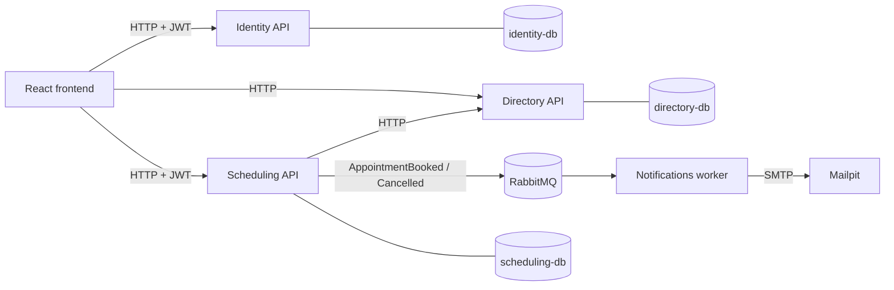

# ClinicBooking

A microservices-based web application for booking doctor appointments. Patients browse doctors and book available time slots, doctors manage their working hours and time off, and admins manage specialties, examination types and doctor accounts. Booking and cancellation trigger email notifications through a message broker.

Built as a learning project to practice microservice architecture with ASP.NET Core and React.

## Features

**Patient**
- Browse doctors, filter by specialty and search by name
- View available time slots and book an appointment
- See upcoming and past appointments, cancel up to 24 hours in advance
- Receive email confirmations for bookings and cancellations

**Doctor**
- Set weekly working hours with multiple breaks per day
- Add time off (vacation, sick leave)
- See and cancel appointments booked with them

**Admin**
- Manage specialties, examination types and doctor profiles
- Find user accounts by email and assign the Doctor role

## Architecture



| Service | Responsibility |
|---|---|
| **Identity.Api** | Registration, login, JWT issuing, roles, user search |
| **Directory.Api** | Specialties, examination types, doctor profiles |
| **Scheduling.Api** | Working hours, time off, available slots, appointments |
| **Notifications.Worker** | Consumes appointment events and sends emails |
| **Contracts** | Shared event definitions used by publisher and consumer |

Each service owns its own PostgreSQL database. Services never read each other's tables: cross-service references (for example a doctor's `UserId`) are plain IDs, and data is exchanged over HTTP or through events.

## Tech stack

- **Backend:** C#, ASP.NET Core Web API (.NET 10), Entity Framework Core, ASP.NET Core Identity, JWT
- **Messaging:** RabbitMQ, MassTransit
- **Database:** PostgreSQL (one per service)
- **Frontend:** React, TypeScript, Vite, React Router, Tailwind CSS
- **Email:** MailKit, Mailpit (local SMTP test server)
- **Infrastructure:** Docker, Docker Compose, Nginx
- **Testing:** xUnit

## Getting started

Requirements: [Docker Desktop](https://www.docker.com/products/docker-desktop/).

1. Clone the repository
   ```bash
   git clone https://github.com/Vasilije30/ClinicBooking.git
   cd ClinicBooking
   ```
2. Create a `.env` file in the root (see `.env.example`) with a JWT signing key of at least 32 characters:
   ```
   JWT_KEY=replace-with-a-long-random-secret-key
   ```
3. Start everything
   ```bash
   docker compose up -d --build
   ```
   Database migrations and roles are applied automatically on startup.

| URL | What |
|---|---|
| http://localhost:5173 | Web application |
| http://localhost:8025 | Mailpit inbox (sent emails) |
| http://localhost:15672 | RabbitMQ management panel |
| http://localhost:5050 | pgAdmin |
| http://localhost:5106, 5107, 5108 | Identity, Directory and Scheduling APIs |

Credentials for pgAdmin and RabbitMQ are defined in `docker-compose.yml` (development values only).

### First admin account

Registration always creates a Patient. To get an admin, register an account and assign the role once in the `identity` database:

```sql
INSERT INTO "AspNetUserRoles" ("UserId", "RoleId")
SELECT u."Id", r."Id"
FROM "AspNetUsers" u, "AspNetRoles" r
WHERE u."Email" = 'admin@example.com' AND r."Name" = 'Admin';
```

Log in again so the new role is included in the token. From there, doctors can be created from the admin panel.

## Design notes

- **Available slots are calculated, not stored.** Slots are computed on request from working hours, breaks, time off and existing bookings. The calculation lives in a pure `SlotCalculator` class covered by unit tests.
- **Double booking protection.** Booking re-calculates slots inside a transaction with a PostgreSQL advisory lock per doctor. A filtered unique index on active appointments is the final safeguard. Cancelled appointments keep their history and free the slot.
- **Time zones.** All timestamps are stored in UTC. Working hours are local clinic time and are converted to UTC per date, so daylight saving time is handled correctly.
- **Ownership checks on the server.** Roles decide which endpoints a user may call, and the user ID from the token decides which data they may change. Doctors can only edit their own schedule.
- **Event-driven notifications.** Scheduling publishes events after committing and does not depend on the notification service. If the worker is down, messages wait in the queue and are processed when it restarts.

### Known limitations

- An event can be lost if RabbitMQ is unavailable right after a booking is committed. A transactional outbox would solve this.
- Scheduling calls Directory synchronously when booking, so booking depends on Directory being available.
- There is no API gateway yet. The frontend calls each service on its own port.

## Project structure

```
src/
├── BuildingBlocks/Contracts/        shared event records
└── Services/
    ├── Identity/Identity.Api/
    ├── Directory/Directory.Api/
    ├── Scheduling/Scheduling.Api/
    ├── Scheduling/Scheduling.Api.Tests/
    └── Notifications/Notifications.Worker/
frontend/                            React application
docker-compose.yml
```

## Running tests

```bash
dotnet test src/Services/Scheduling/Scheduling.Api.Tests
```
